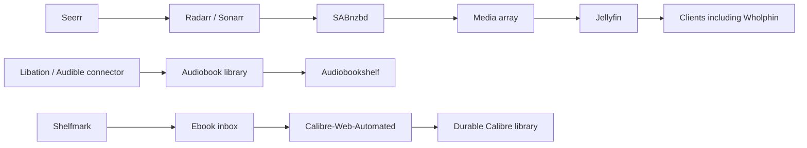

# Architecture

Verified host/container metadata: 2026-09-23. BookStack descriptions below are historical source material cross-checked where noted; see the [inventory](findings/bookstack-inventory.md).

`avrana` is the primary Linux host (Intel Core i3-6100T, four logical CPUs; observed kernel 6.8.0-138-generic). The main operator is `cody` (UID/GID 1000). The LAN service address is `10.0.0.218`. Forty Docker containers were running during inspection, with no unhealthy containers; five had no healthcheck. A healthy status does not establish data completeness or restart safety.

Avrana manages video requests/acquisition/playback, ebooks, audiobooks and comics. Authentik supplies identity services; application-specific accounts and tokens still exist. Homepage and the Avrana portal are entrypoints. Beszel and Tracearr provide host/service and playback monitoring. BookStack preserves the wiki. Home Assistant and local voice services share the host but are separate from the media subsystem.

The pipeline relationships come from BookStack pages 14–26 and 31–33 and recovered source documentation. They are architectural descriptions, not a claim that an end-to-end acquisition test was run this session. Jellyfin's `/data/movies` and `/data/tv` mounts were directly verified read-only.

Production consists of independent Compose projects plus host services. Definitions live across `/home/cody/avrana/services`, `/home/cody/docker`, and system/user systemd configuration. The new development checkout is separate and does not automatically deploy anything. [Services](SERVICES.md) records observed endpoints; [storage](STORAGE.md) records persistent paths.

BookStack pages 55 and 57 describe Kern as a planned umbrella/control plane above Avrana. Do not infer a deployed orchestrator from old Python directories. Page 55 calls Kern HQ planned, but page 62 and live Docker inspection show Home Assistant running; that contradiction is recorded in [decisions](DECISIONS.md).

Avrana Party is a separate Raspberry Pi project (`party.local`, `rcnechamkin/avrana-party`), according to archive pages 87–90. That device was not inspected and is outside this migration's deployment scope.
